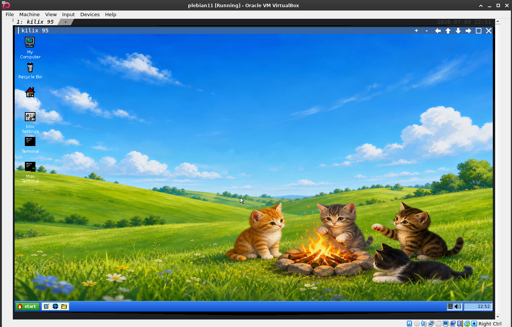

# Kilix 95

A Windows 95-style desktop rendered as **pixels** inside a Kilix pane, with an
optional Windows XP-style flavor.

**Status:** ships in Plebian-OS as the default desktop provider. Plebian-OS
0.2.3 (release candidate `v0.2.3-rc6`) pins `KILIX95_REF=44525e24` in
`releases/0.2.3.env`; [Pleb](https://github.com/itsmygithubacct/pleb#readme)
clones that commit to `~/.local/gpu_terminal/sources/kilix-desktops/kilix-95`
and the login session opens it as page 1. The latest published release is
`v0.2.2` (Plebian-OS 0.2.2). This `main` branch contains the RC6 pin and
carries `VERSION` 0.2.3.

Kilix 95 is the release-default desktop provider in the four-repository
Plebian-OS core. Kilix Cap, Kilix TUI, and Kilix Land are additional optional
desktops with their own integration and release positions.

Kilix 95 is not a window manager for the host X session. It is a Python desktop
surface that draws a complete desktop into a PIL framebuffer, sends that
framebuffer through the Kitty graphics protocol, and routes terminal keyboard
and mouse input back into its own widgets, windows, menus, and apps.

The normal entry point is:

```bash
kilix desktop
```

Quit through Start -> Shut Down..., or press `Ctrl+Alt+Q`.



## What it does

- Draws a whole desktop into one framebuffer: wallpaper, icons, overlapping
  movable and resizable windows, taskbar, Start menu, tray and clock, in the
  Windows 95 or Windows XP look. No Microsoft artwork or fonts are bundled.
- Ships its own apps: File Manager, Notepad, WordPad, Paint, image Viewer,
  Calculator, Character Map, Minesweeper, Solitaire, Settings, Control Panel,
  Task Manager, Recycle Bin, Find Files, Help, System Manual, PTY Sessions,
  Backup and Restore, Document Reader and Model Setup (`apps/`).
- Starts other programs as Kilix tabs or OS windows, X11 programs through
  `kilix run`, and X11 programs inside the desktop through XPane.
- Lists every application in the host's shared catalog under Kilix
  Applications, and installs and boots games through `kilix games play <id>`.
- Edits the user's `kitty.conf` and the shared `settings.conf` from its
  Settings app and reloads Kilix live.
- Offers an optional Windows 95 "full experience" layer (Briefcase, Dial-Up
  Networking, Network Neighborhood, PowerToys and more) that never changes host
  networking or disk contents.
- On Plebian-OS, offers first-run setup windows for the wallpaper, Kilix
  Workflows, system voice and model downloads, and installs the default
  `kilix-female-02` voice.
- Exposes its pixel shell to screen readers through an AT-SPI bridge.

## Install Software and Coding Agents

Start -> Programs -> **Install Software** lists everything `kilix install`
can install, and **Coding Agents** installs the supported coding agents
through the same command. Both arrived in Kilix 95 0.1.8, whose release note
follows; the rest of that release is in
[docs/release-notes.md](docs/release-notes.md#release-018).

Upgrades from 0.1.7.

- Programs gains **Install Software** and a **Coding Agents** entry whose
  context menu reaches Claude Code, Codex and Kimi Code individually. Both run
  `kilix install`, resolved through the Kilix launcher the same way the model
  store and the TUI desktop resolve it, so what the menu offers and what the
  command prints cannot drift. That matters most for the agents, which install
  by running a vendor script fetched over the network: `kilix install` prints
  the command and its documentation URL and asks first, and a menu entry that
  shelled out on its own would be the version of this with no such step.

## Watch the episode

https://github.com/user-attachments/assets/fe477615-845b-4d53-b568-e1eca849a8d8

**[Desktop One: Kilix 95 and XP](https://github.com/itsmygithubacct/kilix-95/releases/download/media-v1/05-kilix-95-and-xp.mp4)**
— part five of *Kilix, Pleb, and Plebian-OS: A Desktop Built Inside a Terminal*, the ten-part
stack series. The inline player is a 720p preview; the link is the full-quality file (1920×1080,
3m27s, 16 MB; published as a
[media release](https://github.com/itsmygithubacct/kilix-95/releases/tag/media-v1) so a clone
stays small). The [full series](https://github.com/itsmygithubacct/plebian-os#watch-the-series) (31m22s)
lives on `plebian-os` and plays at [plebian-os.com](https://plebian-os.com/#watch).

## Quick Start

From a normal Kilix session:

```bash
kilix desktop
```

On Plebian-OS this opens Kilix 95. `kilix xp` opens it with the XP flavor, and
`KILIX_DESKTOP_FLAVOR=95|xp` selects the flavor on first launch.

For local development from this checkout:

```bash
cd ~/.local/gpu_terminal/sources/kilix-desktops/kilix-95
KILIX_HOME=~/.local/gpu_terminal/sources/kilix python3 main.py
```

For screenshot/test rendering without taking over the terminal:

```bash
KILIX_HOME=~/.local/gpu_terminal/sources/kilix \
  python3 main.py --screenshot /tmp/shot.png --scene all
```

Useful screenshot scenes:

```text
desktop start filemgr notepad settings dialog launcher menu startup shutdown bsod all
```

Run the tests with `python3 tests/run.py` (see [docs/development.md](docs/development.md)).

## Usage

| command | effect |
|---|---|
| `kilix desktop` | open the selected desktop provider (Kilix 95 on Plebian-OS) |
| `kilix xp` | open Kilix 95 with the XP flavor |
| `python3 main.py` | run this checkout inside a Kilix pane (set `KILIX_HOME`) |
| `python3 main.py --dir PATH` | use PATH as the desktop folder |
| `python3 main.py --no-cursor` | do not draw the desktop's own pointer |
| `python3 main.py --screenshot OUT.png --scene NAME --size WxH` | render offscreen and exit (default `desktop`, `1024x768`) |
| `python3 main.py --version` | print the version without needing the native state library |
| `python3 tests/run.py [substring ...]` | run each `tests/test_*.py` in an isolated subprocess |

| key | effect |
|---|---|
| tap Super, or `Ctrl+Escape` | open or close the Start menu |
| `Alt+Tab` | window switcher |
| `Ctrl+Alt+Q` | quit the desktop |
| right click | context menu on the desktop, icons and windows |

The desktop folder is `~/.local/gpu_terminal/kilix-95/data/desktop`; files
placed there appear as icons, and `.desktop` files appear as launchers. See
[docs/launchers.md](docs/launchers.md) for the `X-Kilix-Open` launch modes.

## How it works

```text
 kilix desktop
      |  Kilix launcher validates provider.json, passes KILIX_HOME
      v
 main.py (Desk) --- kilix_sdk (term, graphics, state, settings, clipboard, xapp)
      |
      |  input dispatch: menus | drag owner | window | taskbar | shell
      v
 widgets / wm / taskbar / shell / apps  --->  PIL RGB framebuffer
                                                   |
             Kitty graphics: private file (t=t) or inline (t=d)
                                                   v
                                              Kilix pane
      ^                                            |
      +---- Kitty keyboard protocol + SGR-pixel mouse reports
```

The Kilix launcher selects this checkout as the `external` desktop provider,
checks the data-only `provider.json` (provider API 1, `kilix_sdk` 1.16, and the
security features it implements), and starts `main.py` with `KILIX_HOME` set.
`main.py` repeats the SDK check at runtime and refuses an incompatible host.
Everything specific to the desktop lives here; terminal parsing, Kitty
graphics, crash-safe state, shared settings, clipboard and private X sessions
come from the host's `kilix_sdk`.

Rendering is damage-driven: input, resize, the clock, caret blink, app updates
and screen savers mark the desktop dirty, and only then is the framebuffer
redrawn and placed through the Kitty graphics protocol. Local sessions pass
frames as private files; streamed `kilix serve` sessions send them inline.
Mouse reports use SGR pixel coordinates, so they map directly onto
framebuffer pixels. [docs/architecture.md](docs/architecture.md) has the module
map and the input dispatch order.

Programs leave the desktop through the host: `kitten @ launch` for tabs and OS
windows, `kilix run` for X11 apps in a Kilix tab, and XPane for X11 apps that
should stay inside the desktop (a private Xvfb captured with ffmpeg, with
XTest input and a clipboard bridge; see [docs/xpane.md](docs/xpane.md)).
Games and catalog apps install through the host's content catalog, so every
desktop runs the same pinned build. Runtime state lives under
`~/.local/gpu_terminal/kilix-95`, never in the checkout
([docs/runtime-state.md](docs/runtime-state.md)).

## Documentation

| document | contents |
|---|---|
| [docs/architecture.md](docs/architecture.md) | relationship to the Kilix host, rendering and input, main modules |
| [docs/desktop-guide.md](docs/desktop-guide.md) | Start menu, Windows 95 nostalgia features, Help and manuals, desktop flavor |
| [docs/launchers.md](docs/launchers.md) | launch modes, the desktop folder and `.desktop` launchers |
| [docs/apps.md](docs/apps.md) | built-in apps and file associations |
| [docs/settings.md](docs/settings.md) | the Settings app: files it writes, tabs, live reload |
| [docs/xpane.md](docs/xpane.md) | embedding X11 apps in desktop windows |
| [docs/games.md](docs/games.md) | the Games menu, installers and game readiness |
| [docs/startup-and-voice.md](docs/startup-and-voice.md) | Kilix Workflows, system voice, Document Reader, model setup |
| [docs/runtime-state.md](docs/runtime-state.md) | state and user-data locations, resetting them, environment variables |
| [docs/development.md](docs/development.md) | requirements and the test suite |
| [docs/troubleshooting.md](docs/troubleshooting.md) | common failures and what to check |
| [docs/release-notes.md](docs/release-notes.md) | release history from 0.1.1 to the 0.2.2.1 maintenance candidate |
| [assets/sounds/README.md](assets/sounds/README.md) | the bundled sound schemes and their provenance |

## Related repositories

- [Kilix](https://github.com/itsmygithubacct/kilix#readme): the host terminal;
  its launcher starts this provider and its `kilix_sdk` supplies the terminal,
  graphics, state, settings and catalog layers. Kilix also bundles a fallback
  copy of the desktop.
- [Pleb](https://github.com/itsmygithubacct/pleb#readme) installs this
  repository and starts it in the login session;
  [Plebian-OS](https://github.com/itsmygithubacct/plebian-os#readme) pins the
  revision.
- [kilix-desktop-sdk](https://github.com/itsmygithubacct/kilix-desktop-sdk#readme):
  the desktop SDK parent repository, which carries a mirrored copy of this
  provider with declared adaptations.
- [kilix-content](https://github.com/itsmygithubacct/kilix-content#readme): the
  content catalog behind Kilix Applications and the Games menu.
- [kilix-state](https://github.com/itsmygithubacct/kilix-state#readme): the
  native crash-safe state library behind `kilix_sdk.state`.
- [kilix-voice](https://github.com/itsmygithubacct/kilix-voice#readme) and
  [kilix-piper-tts](https://github.com/itsmygithubacct/kilix-piper-tts#readme):
  read-aloud, dictation and the system voice.
- [kilix-amp](https://github.com/itsmygithubacct/kilix-amp#readme) and
  [kilix-games](https://github.com/itsmygithubacct/kilix-games#readme): the
  media player and games the desktop installs on demand.
- Other Kilix desktops: [Kilix Cap](https://github.com/itsmygithubacct/kilix-cap#readme),
  [Kilix Land](https://github.com/itsmygithubacct/kilix-land-desktop#readme),
  [Kilix IceWM](https://github.com/itsmygithubacct/kilix-icewm#readme) and the
  Kilix TUI desktop in [kilix-tui-utils](https://github.com/itsmygithubacct/kilix-tui-utils#readme).

## Fonts And Authenticity

No Microsoft artwork or fonts are bundled. Icons are original pixel art and
text is DejaVu Sans 11px rendered without antialiasing. If you own period fonts,
drop `.ttf` or `.otf` files into `assets/fonts/` (gitignored) and they are
picked up by preference.

## Part of Plebian-OS

Kilix 95 is one of the repositories behind
[Plebian-OS](https://github.com/itsmygithubacct/plebian-os#readme), a Debian
install whose desktop is [Kilix](https://github.com/itsmygithubacct/kilix#readme)
running the [Kilix 95](https://github.com/itsmygithubacct/kilix-95#readme)
desktop through [Pleb](https://github.com/itsmygithubacct/pleb#readme).
It is the default desktop: Plebian-OS pins its revision and Pleb clones it at
first boot. The map of every repository and how it ships is on the
[components page](https://github.com/itsmygithubacct/plebian-os/blob/main/docs/components.md).

## License

Kilix 95 is released under the [GNU General Public License version 3](LICENSE)
(`GPL-3.0-only`).
