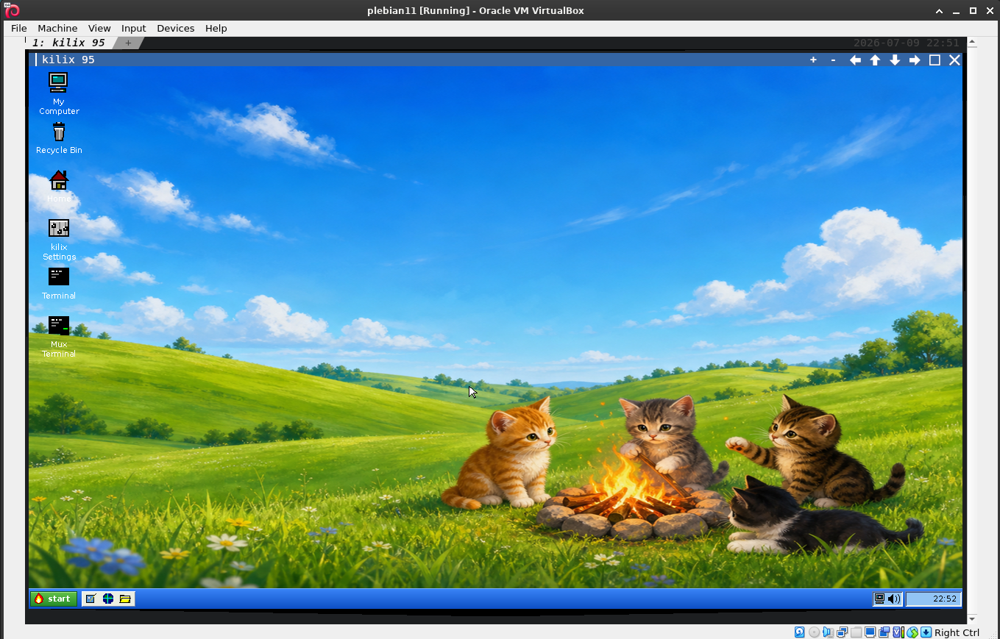

# Using the Kilix 95 desktop

The Start menu, the optional Windows 95 nostalgia layer, Help and the System Manual, and the 95/XP flavor switch. Moved from the [README](../README.md).

## Start Menu

The Start menu is built in `taskbar.py`.

Top-level sections:

- **Programs**: built-in accessories, games, the shared Kilix Applications
  catalog, browsers, terminals, PTY Sessions, Kilix Temps, Kilix Memory, Tmux
  Manager, BitNet Models, the MS-DOS Prompt/DOSBox caller, user launchers, and
  discovered XDG apps. PowerToys and the optional classic folders appear when
  the full experience is active.
- **Documents**: recently opened files.
- **Settings**: Control Panel, Kilix settings, display properties, sound
  schemes, and desktop flavor.
- **Help**: Help Topics, project how-tos, terminal how-tos, System Manual.
- **System**: update and maintenance entries when the relevant helpers exist.
- **Find**: file search.
- **Run**: command launcher.
- **Shut Down**: shutdown, restart, exit-to-terminal, update-and-restart.

The menu is data-driven through `widgets.MenuItem`, so submenus can be nested
without new widget code.

## Windows 95 Nostalgia Features

Kilix 95 starts with a lean desktop. Select **Activate full experience** in
kilix Settings -> Behavior to expose the optional nostalgia layer. The choice
is saved in desktop state and applied immediately; no restart is needed.

The classic additions are functional, with host-facing behavior kept read-only
or explicitly user-triggered:

- Control Panel and five-tab Display Properties cover original themes,
  wallpaper patterns, sound/pointer schemes, eight screen savers, local
  password protection, and RTM/Plus!/late-Win9x/Kilix-XP presentation profiles.
- My Computer includes a not-ready floppy, mounted removable media, a managed
  read-only Kilix 95 CD-ROM, Control Panel, Printers, Dial-Up Networking,
  Network Neighborhood, My Briefcase, and Recycle Bin.
- Network Neighborhood maps configured SSH aliases to real SSH tabs and
  explicitly configured local shares to File Manager. Dial-Up Networking
  stages an original modem sound before handing off to the normal browser; it
  never changes host networking.
- Device Manager and Add New Hardware inspect hardware without mounting disks
  or installing drivers. Printers discovers CUPS queues read-only and supports
  virtual print-to-folder destinations.
- My Briefcase performs non-destructive two-folder synchronization: deletions
  are not propagated and two-sided conflicts are never overwritten. Send To
  uses non-overwriting copies.
- PowerToys supplies Command Prompt Here, Explore From Here, QuickRes,
  DeskMenu, Send To settings, TweakUI, Round Clock, and a safe disk-map theater
  that never rearranges host data.

With the full experience disabled, Briefcase, dial-up/modem theater, Network
Neighborhood, Printers, PowerToys, hardware/defrag tools, the fake floppy and
managed CD-ROM, Send To additions, device notifications, and first-run Welcome
stay out of the desktop and menus.

Classic interaction details include keyboard menu accelerators, outline-only
window dragging, minimize/restore animation, configurable pointers, a busy
hourglass, Quick Launch, device and connection tray indicators, property
sheets, and first-run Welcome/Did You Know help.

## Help And Manuals

Start -> Help contains:

- **System Manual**: searchable browser for installed man pages.
- **List**: opens the System Manual browser with the full local man-page list.
- **Pleb Recovery Guide**: opens `/usr/local/share/doc/pleb/RECOVERY.md`, falling
  back to `$GPU_TERMINAL_SOURCE_HOME/pleb/docs/RECOVERY.md` for source runs.
- **Kilix**: how-tos for Kilix, Kilix 95, Pleb, and Plebian-OS.
- **Terminal**: how-tos for terminal basics, tmux, and bash.
- **Help Topics**: the general two-pane desktop guide.

The System Manual browser scans the active manpath, lists entries as
`name (section)`, and renders the selected page in a read-only text pane.
It uses `man <section> <name>` with pager output disabled, then strips terminal
formatting so the result is readable in the desktop text widget.

Blue underlined Help links are live links. They call
`Shell.open_default_browser_tab()`, which uses this fixed browser order:

1. `google-chrome`
2. `google-chrome-stable`
3. `chromium`
4. `chromium-browser`
5. `firefox-esr`
6. `firefox`

Launcher URL files and Start -> Programs -> Web Browser use the same policy.
The experimental in-pane browser is only the no-real-browser fallback.

Current built-in Help link targets include:

- Kilix repository
- Kilix 95 repository
- Pleb repository
- Plebian-OS repository
- GNU Bash manual
- Bash source repository
- tmux project
- tmux manual
- Linux man-pages project

## Desktop Flavor

Switch at runtime from:

```text
Start -> Settings -> Desktop Flavor
```

The same selector is available in kilix Settings on the Appearance tab.

The choice is saved in desktop state. For screenshots or first launch before
state exists:

```bash
KILIX_DESKTOP_FLAVOR=xp kilix desktop
KILIX_DESKTOP_FLAVOR=95 kilix desktop
```

`KILIX_FLAVOR` is also accepted as a fallback.

XP flavor reference:


